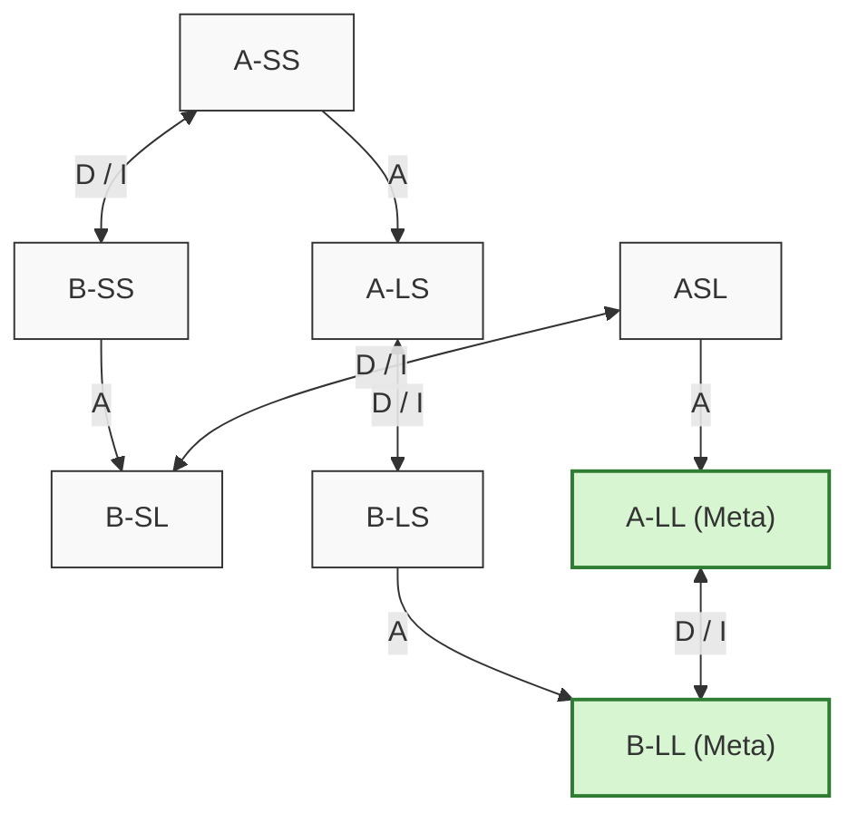

# Fundamentos Teóricos: El Mundo de la Aspiradora y Búsqueda de Costo Uniforme (UCS)

Este documento detalla la fundamentación teórica, el modelado formal y el algoritmo de búsqueda implementado en este repositorio.

---

## 1. El Problema del Mundo de la Aspiradora

Basado en el problema clásico presentado por Stuart Russell y Peter Norvig en *Artificial Intelligence: A Modern Approach*:
- Existen **2 ambientes o habitaciones**: `A` (izquierda) y `B` (derecha).
- Cada habitación puede estar **Limpia (`L`)** o **Sucia (`S`)**.
- El agente (aspiradora) puede encontrarse en la habitación `A` o en la `B`.

### 1.1. Espacio de Estados
El espacio total consta de $2 \times 2^2 = 8$ estados posibles:

| Estado | Posición Agente | Habitación A | Habitación B | ¿Es Meta? |
| :---: | :---: | :---: | :---: | :---: |
| `A-SS` | A | Sucia | Sucia | No |
| `B-SS` | B | Sucia | Sucia | No |
| `A-LS` | A | Limpia | Sucia | No |
| `B-LS` | B | Limpia | Sucia | No |
| `A-SL` | A | Sucia | Limpia | No |
| `B-SL` | B | Sucia | Limpia | No |
| `A-LL` | A | Limpia | Limpia | **Sí** |
| `B-LL` | B | Limpia | Limpia | **Sí** |

### 1.2. Conjunto de Acciones
1. **`I` (Izquierda):** Mueve la aspiradora al ambiente `A`. Si ya está en `A`, no cambia su posición.
2. **`D` (Derecha):** Mueve la aspiradora al ambiente `B`. Si ya está en `B`, no cambia su posición.
3. **`A` (Aspirar):** Limpia la habitación actual. Si la habitación ya está limpia, no altera el estado.

---

## 2. Búsqueda de Costo Uniforme (UCS - Uniform Cost Search)

La **Búsqueda de Costo Uniforme** es una variante del algoritmo de Dijkstra adaptada a la búsqueda en espacios de estados / grafos dirigidos.

### 2.1. Propiedades Teóricas
- **Función de evaluación:** $f(n) = g(n)$, donde $g(n)$ es el costo acumulado desde el nodo raíz hasta el nodo $n$.
- **Estructura de la Frontera:** Cola de prioridad (*Min-Heap*). En cada iteración se extrae el nodo con el menor costo $g(n)$.
- **Desempate:** En caso de empate en $g(n)$, se aplica el orden de inserción (FIFO), garantizando determinismo.
- **Prueba de Meta:** Se evalúa **al extraer el nodo de la frontera**, no al generarlo. Esta condición es fundamental para garantizar **optimalidad** en grafos con costos de aristas no negativos ($c \ge 0$).
- **Completitud y Optimalidad:** UCS es completo y óptimo siempre que el costo de cada paso sea estrictamente positivo ($c(s, a, s') \ge \epsilon > 0$).

---

## 3. Grafo del Espacio de Estados

---

## 4. Estructura de Datos y Clases

1. **`Accion`:** Encapsula el identificador ('I', 'D', 'A') y representación textual.
2. **`Estado`:** Modela el nombre ('A-SS', etc.), coordenadas espaciales y estado de suciedad.
3. **`Problema`:** Define el estado inicial, función de transición $T(s, a)$, función de costo $c(s, a)$ y test de objetivo.
4. **`Nodo`:** Encapsula un estado, apuntador al padre, acción generadora y costo acumulado $g(n)$.
5. **`AgenteBusqueda`:** Orquesta la cola de prioridad (`heapq`), control de cerrados/explorados y registro del paso a paso.
